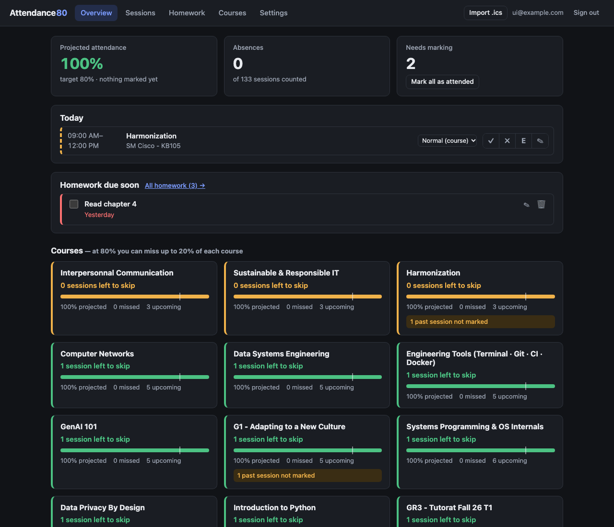
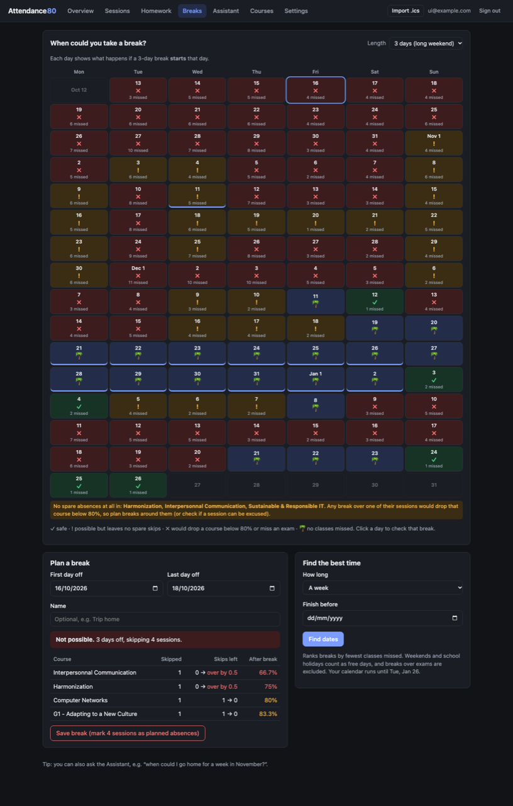
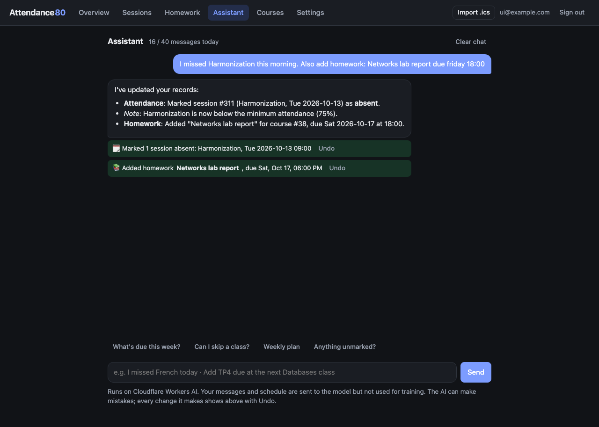

# Attendance80

**Stay above the attendance minimum without counting by hand.** Import your university calendar (`.ics`), tick off each session, and always know how many classes you can still miss in every course. It also tracks homework, plans holidays, and has an AI assistant.

Live at **[epita.knhdixh.com](https://epita.knhdixh.com)** · Runs on one Cloudflare Worker + D1 · No runtime dependencies



## Features

| | |
|---|---|
| 🔑 **Sign in without Google** | Create an account with a **passkey** (Face ID, fingerprint, PIN, or a passkey synced via iCloud, Google Password Manager or 1Password). No password, and no Google approval needed. Google sign-in stays available, and Google users can add a passkey too. |
| 📅 **Calendars** | Add several calendars: Zeus links (*Generate my link*) or any other `.ics` link, re-imported automatically every hour, and uploaded `.ics` files you can replace with a newer version. Each can be renamed, updated or removed, with a log of every import in Settings. Re-importing one calendar never touches another, and a session in two calendars is counted once. Re-imports match sessions by UID, so your marks are kept. Group-split courses (`GR1 – …`, `GR12 – …`) are hidden until you pick your group. |
| ✅ **Attendance** | Mark each session ✓ attended, ✗ absent (on a future session this means a *planned* skip) or **E** excused. Each course shows its projected %, absences used, and how many sessions you can still skip. |
| 🏷 **Tags** | Normal / Mandatory / Exam / Optional, per course or per session. Skipping an exam or mandatory session is flagged; Optional sessions never count. |
| 📚 **Homework** | Due dates, or "due at the next session of X", reminders and notes. Overdue items appear on the overview, and each session shows the homework due at it. |
| 🔔 **Google Calendar sync** | Todoist-style: homework is pushed to a *Homework (Attendance80)* calendar, and reminders arrive as Google Calendar notifications. There's also a private `.ics` feed for Apple Calendar or Outlook. |
| 🗓 **Calendar feeds** | Two private links for Google Calendar, Apple Calendar or Outlook: your timetable (every session of your groups, as on Zeus, following Zeus updates) and, optionally, your homework. |
| ⏱ **Focus** | A Pomodoro timer (25/5 min, a long break every 4, all adjustable) that can be pointed at a homework item, a course or one of your own tasks ("Thesis: literature review"), with tags such as *reading* or *coding*. Press **F** anywhere to start or pause; a mini timer stays in the top bar, the sidebar and the tab title, and a sound and notification mark the end of each phase. The timer survives reloads and is shared across tabs, and finished sessions are saved even if you were offline. Stats: today against a daily goal, streak, this week against last, time per course, task and tag, and a year heatmap. |
| 🌴 **Break planner** | A calendar showing, for a break length you choose (1 day to 2 weeks), whether a break starting on each day is safe, a preview of any date range per course, and a finder for the best N-day break that skips the fewest classes, uses weekends and school holidays, and never covers an exam. |
| ☀️ **Today** | The home page: what's on now and next, a single *Do next* list (homework and catch-ups ranked by the latest time you can start them), today's free time between classes with the to-dos that fit in it, overlapping sessions this week, and how much work is due against how much free time you have. Computed by the app ([`public/plan.js`](public/plan.js)), no AI. |
| 🇫🇮 **Sisu (Tampere and other Finnish universities)** | Paste the Sisu *Export into external calendar* link. Sessions are grouped by course code ("Deep Learning · Lecture"), and Sisu calendars don't count attendance by default (any calendar can turn it off in Settings): their courses appear in the timetable and the plan, without the 80% maths. |
| ↺ **Catch-ups** | Missed a class? Marking it absent (or ↺ on any past session) adds "Catch up: …" to your list, due before the course meets again, with the course's recordings link (set it in Courses). |
| 📱 **Install it** | The site is an installable app (Chrome: *Install app*; Safari: *Add to Home Screen*), and [`android/`](android) builds an Android APK that opens it full screen. Notifications go through a small service worker that caches nothing. |
| 🔑 **Claude Code access** | Personal tokens (read, or read and write) for `GET /api/plan` (which includes a focus summary), `GET /api/focus` and the homework, catch-up and attendance endpoints, so a script or Claude Code can plan with your data. |
| 🤖 **AI assistant** | "Can I take next week off?", "I missed French today", "add TP4 due friday", "make my weekly plan". All maths and dates are done by the app, not the model, and every change it makes can be undone. |

<table>
<tr>
<td></td>
<td></td>
</tr>
</table>

## How the numbers work

For each tracked course:

| | |
|---|---|
| **total** | all sessions, minus excused and Optional ones (in sessions or hours, set in Settings) |
| **allowed absences** | `total × (1 − minimum)`. At 80%, 10 sessions allow 2 absences, and 4 sessions allow **none** |
| **left to skip** | allowed − absences (past and planned), rounded down |
| **projected** | `(total − absences) / total`. Unmarked sessions are assumed attended |

A course turns amber when it has less than one skip left or a missed exam, and red when it's below the minimum.

## Stack

- **Cloudflare Worker**: the API, Google OAuth and static frontend in one deployment ([`src/worker.js`](src/worker.js))
- **D1** (SQLite) for storage; schema in [`migrations/`](migrations)
- **Workers AI** (Gemma 4) for the assistant. It uses Cloudflare's free daily allocation, and prompts are not used for training
- **Plain JavaScript** frontend with no build step. The attendance and break-planning maths ([`public/stats.js`](public/stats.js), [`public/breaks.js`](public/breaks.js)) is shared by the browser and the Worker

```
src/
  worker.js          routing, auth, REST API
  calendars.js       calendars (links and files), ICS import, scheduled link refresh
  calendar-link.js   calendar link validation (Zeus and other .ics links) and download
  ics.js             iCalendar parser (folding, escaping, TZID/UTC/all-day)
  assistant.js       AI assistant: context, tools, chat loop, daily limit
  gcal.js            Google Calendar sync (encrypted refresh tokens)
  homework*.js       homework validation, persistence, .ics feed
  breaks-store.js    saving/removing breaks
  focus.js           focus sessions and timer settings
public/
  app.js             UI shell: overview, sessions, courses, settings
  *-ui.js            homework, breaks and assistant tabs
  stats.js, breaks.js, focus.js  shared maths (attendance, breaks, the focus timer and its stats)
test/                node:test suites (no network, D1 shimmed with node:sqlite)
```

## Run locally

Requires Node 22+.

```bash
npm install
cp .dev.vars.example .dev.vars   # DEV_LOGIN=1 gives a passwordless test login at /auth/dev
npm run dev                      # migrates the local D1 and serves http://localhost:8787
npm test
```

## Deploy your own

1. **Cloudflare**
   ```bash
   npx wrangler login
   npx wrangler d1 create epita-attendance     # put the printed database_id in wrangler.jsonc
   ```
   In `wrangler.jsonc`, set `routes` / `CANONICAL_HOST` to your domain, or remove them to use `*.workers.dev`.

2. **Google OAuth client** (optional: passkeys work without it) ([Cloud Console](https://console.cloud.google.com/auth/clients))
   - Create a *Web application* client. Its **Authorized redirect URIs** must list every address the app is served from:
     `https://<your-domain>/auth/google/callback` and `http://localhost:8787/auth/google/callback`
   - For calendar sync: enable the **Google Calendar API** and add the scope
     `https://www.googleapis.com/auth/calendar.app.created` under *Data Access*.
   - **Publish** the app, or add test users.

3. **Secrets and deploy**
   ```bash
   npx wrangler secret put GOOGLE_CLIENT_ID
   npx wrangler secret put GOOGLE_CLIENT_SECRET
   openssl rand -base64 32 | tr -d '\n' | npx wrangler secret put TOKEN_KEY
   npm run deploy                                # applies D1 migrations, then deploys
   ```

### Continuous deployment

Pushes to `main` deploy automatically through **Workers Builds** (Cloudflare dashboard → *epita-attendance → Settings → Builds*):

| Setting | Value |
|---|---|
| Repository / branch | `knhdixh/epita-attendance` / `main` |
| Build command | *(empty)* |
| Deploy command | `npm run deploy` (applies new D1 migrations, then `wrangler deploy`) |
| API token | the build token, with **D1 → Edit** added so migrations can run |

Runtime secrets (`GOOGLE_*`, `TOKEN_KEY`) stay on the Worker and are not part of the build.

### Android app

[`android/README.md`](android/README.md): build the APK with Bubblewrap, then put its key's SHA-256 in
`ANDROID_CERT_SHA256` so `/.well-known/assetlinks.json` lets it open full screen.

### Staging

A separate Worker, `epita-attendance-staging`, serves **[epita-staging.knhdixh.com](https://epita-staging.knhdixh.com)** for trying out designs. It has its own D1 database (`epita-attendance-staging`), secrets and passkeys, so nothing done there touches production. It is the `staging` environment in `wrangler.jsonc`.

```bash
npm run deploy:staging    # applies migrations to the staging DB, then deploys the staging Worker
```

Pushes to the `design` branch deploy it automatically through a second Workers Builds connection on the staging Worker (branch `design`, deploy command `npm run deploy:staging`). Staging's assistant budget is kept small because Workers AI's free neurons are shared across the account.

Settings in `wrangler.jsonc`:

| Variable | Default | |
|---|---|---|
| `ALLOWED_DOMAIN` | *(empty)* | Only allow sign-in from this email domain, e.g. `epita.fr` |
| `CANONICAL_HOST` | `epita.knhdixh.com` | Redirects `*.workers.dev` to this host |
| `AI_DAILY_LIMIT` | `40` | Assistant messages per user per day |
| `AI_MODEL` | `@cf/google/gemma-4-26b-a4b-it` | Workers AI model with function calling |

Never set `DEV_LOGIN` in production.

## Limitations

- Recurring events (`RRULE`) are imported once, not expanded. The school's export doesn't use them.
- The free Workers AI allocation (10,000 neurons/day) covers roughly 100–150 assistant messages a day across all users.
